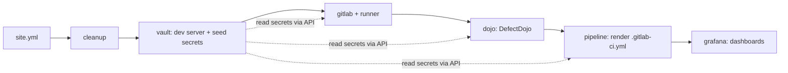

# ⚙️ DevSecOps Ansible Automation

An Ansible-native reimplementation of the [DevSecOps Pipeline Suite](https://github.com/nargiz5/devsecops-pipeline) — the same Vault → GitLab → DefectDojo → Grafana security stack, but provisioned through taggable Ansible roles that rebuild the stack from a clean state, instead of a monolithic bash script.

Where the original bootstraps everything with `bootstrap.sh` and static `.env` values, this version treats **Vault as a live secret store**: each role fetches what it needs from Vault at runtime and writes new secrets (tokens, API keys, project IDs) back into it as the stack comes online.

---

## 📐 What Gets Provisioned

```
site.yml (targets: localhost)
   │
   ├─ cleanup   → stop/remove any previous stack (containers, volumes, networks)
   ├─ docker    → install Docker Engine, log in to Docker Hub, configure insecure registry
   ├─ vault     → run HashiCorp Vault (dev mode), seed initial secrets
   ├─ gitlab    → start GitLab CE + Runner, create root/admin/user accounts,
   │              import target project, register the runner, push tokens back to Vault
   ├─ dojo      → clone & start DefectDojo, create admin user, generate API key,
   │              create a Product + Engagement, push results back to Vault
   ├─ pipeline  → render .gitlab-ci.yml from a Jinja2 template using live Vault data,
   │              push it into the imported GitLab project via the API
   └─ grafana   → (re)generate provisioning files from templates, start Grafana,
                  wire up the DefectDojo Postgres datasource + dashboard
```

Every role after `vault` follows the same pattern: **pull secrets → do the work → write results back**, so the Vault entry at `secret/data/devsecops` ends up as a running record of the entire environment (tokens, project IDs, API keys) instead of a static seed file.

---

## 🔄 Provisioning Flow



---

## 🧰 Stack

| Component | Role file | Notes |
|---|---|---|
| **Docker Engine** | `roles/docker` | Installed from the official Docker apt repo; configures an insecure local registry |
| **HashiCorp Vault** | `roles/vault` | Runs in dev mode; central store for every credential used downstream |
| **GitLab CE + Runner** | `roles/gitlab` | Full account/project/runner bootstrap via `gitlab-rails runner` and the REST API |
| **DefectDojo** | `roles/dojo` | Cloned from upstream, brought up via its own `docker compose`, configured via Django shell |
| **Pipeline generation** | `roles/pipeline` | Renders and pushes `.gitlab-ci.yml` dynamically from Vault-sourced values |
| **Grafana** | `roles/grafana` | Provisioning (datasource + dashboard) fully templated and regenerated on each run |
| **Cleanup** | `roles/cleanup` | Tears down this stack's known containers and volumes before a fresh run (other Docker data on the host is left alone) |

---

## 📁 Project Structure

```
devsecops-ansible/
├── site.yml                  # Master playbook — orchestrates all roles against localhost
├── inventory.ini             # Single-host local inventory
├── group_vars/
│   └── all.yml.example        # Variable template; copy to all.yml and encrypt with Ansible Vault
└── roles/
    ├── cleanup/tasks/
    ├── docker/tasks/
    ├── vault/tasks/
    ├── gitlab/tasks/
    ├── dojo/tasks/
    ├── pipeline/
    │   ├── tasks/
    │   └── templates/gitlab-ci.yml.j2
    └── grafana/
        ├── tasks/
        └── templates/
            ├── docker-compose.yml.j2
            ├── ds_dojo.yaml.j2
            ├── dashboard_config.yaml.j2
            └── security_dashboard.json.j2
```

---

## 🔑 Secret Management

All variables (`vault_token`, `root_password`, `dockerhub_pat`, `telegram_token`, etc.) are meant to live in **`group_vars/all.yml`, encrypted with Ansible Vault (AES256)** — nothing sensitive is ever committed in plain text.

At runtime, the flow is:

1. `roles/vault` starts a Vault dev server and seeds it with the initial values from `group_vars/all.yml`
2. Every subsequent role (`gitlab`, `dojo`, `pipeline`, `grafana`) reads what it needs from Vault over its HTTP API using `vault_token`, rather than referencing Ansible variables directly
3. Roles that generate new credentials (GitLab tokens, DefectDojo API keys, project IDs) merge them back into the same Vault path, so the running environment's state is always retrievable from Vault — not scattered across role outputs

### Creating `group_vars/all.yml`

The repository ships only `group_vars/all.yml.example`, a template with placeholder values. `group_vars/all.yml` itself is git-ignored. Create your own encrypted copy before running the playbook:

```bash
cp group_vars/all.yml.example group_vars/all.yml
# replace every placeholder with your own values, then:
ansible-vault encrypt group_vars/all.yml
```

Choose a strong vault password; you will need it every time you run the playbook. There is no shared or default vault password; each user creates and keeps their own.

The pipeline scans [django.nv](https://gitlab.practical-devsecops.training/pdso/django.nv), an intentionally vulnerable Django application published by Practical DevSecOps, which `import_url` points to.

---

## 🚀 Usage

### Prerequisites

- Ubuntu 22.04+ target host (this playbook targets `localhost` by default — see `inventory.ini`)
- Ansible ≥ 2.14
- The `community.docker` collection:
  ```bash
  ansible-galaxy collection install community.docker
  ```
- Docker Hub account (for the `docker` role's registry login) and a Telegram bot (for pipeline alerts)

### 1. Clone the repository

```bash
git clone https://github.com/nargiz5/devsecops-ansible.git
cd devsecops-ansible
```

### 2. Create your own secrets file

Follow the **"Creating `group_vars/all.yml`"** section above to generate your own encrypted `group_vars/all.yml`.

### 3. Run the full playbook

```bash
ansible-playbook -i inventory.ini site.yml --ask-vault-pass
```

### 4. Or run a single stage with tags

Every role is tagged, so you can re-provision just one piece without tearing down the rest:

```bash
ansible-playbook -i inventory.ini site.yml --ask-vault-pass --tags gitlab
ansible-playbook -i inventory.ini site.yml --ask-vault-pass --tags grafana
```

Available tags: `cleanup`, `docker`, `vault`, `gitlab`, `dojo`, `pipeline`, `grafana`.

---

## ⚠️ Security Notes

- **Only a template is committed.** `group_vars/all.yml` is git-ignored, so an encrypted secrets file never ends up in the repository.
- **Never commit `group_vars/all.yml` unencrypted.** If you ever save it with `ansible-vault` disabled, rotate every credential inside it immediately and re-encrypt.
- The Vault instance here runs in **dev mode** (`vault server -dev`) for lab convenience — it auto-unseals and is not meant for production use. Swap in a properly initialized, unsealed Vault before using this outside a lab.
- `roles/cleanup` force-removes containers and volumes by name — review the list before running it against anything other than this lab's own stack.
- Rotate the vault password itself periodically, and never reuse it as a service password elsewhere in the stack.
- All service passwords are read from Vault (for example `dojo_db_password` and `grafana_password`); no plain-text credentials are stored in tracked files.
- **The security gate fails closed.** It only checks the findings of the current DefectDojo import, and if DefectDojo cannot be queried or returns an unexpected answer, the pipeline fails instead of passing.
- **Secrets stay out of Ansible output.** Every task that handles a password, token or API key runs with `no_log: true`.
- **Lab shortcut:** the rendered `.gitlab-ci.yml` embeds the DefectDojo API key, registry credentials and Telegram token as plain CI variables, so anyone with read access to the GitLab project can see them. In production, store these as masked and protected GitLab CI/CD variables instead.
- Container images use the `:latest` tag for convenience. Pin exact versions or digests for reproducible and supply-chain-safe deployments.

---

## 📄 License

Released under the [MIT License](LICENSE). Intended for educational and lab use.
